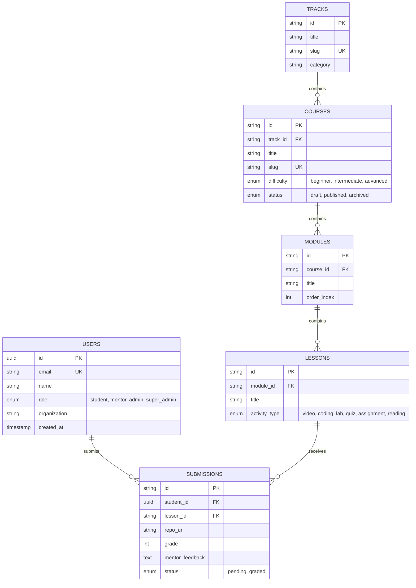
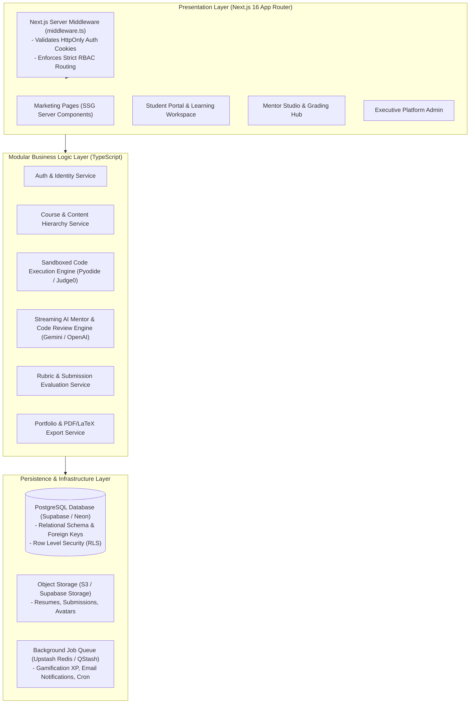
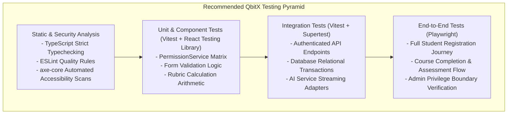

# QbitX — Complete Codebase, Architecture, Feature & Software Quality Audit

**Report Title:** Comprehensive Pre-Rebuild Technical Architecture, Feature Implementation & Software Quality Audit  
**Target System:** QbitX (AI-Powered Project-Based EdTech Platform)  
**Repository:** `QbitX` (`https://github.com/labib-0/QbitX`)  
**Active Branch:** `main` | **Inspected Commit:** `28bc8e5`  
**Live Deployment Reference:** `https://qbitx.vercel.app/`  
**Audit Date:** November 17, 2026  
**Auditor:** Multidisciplinary Senior Engineering Audit Team (Architecture, TypeScript, Backend/DB, Application Security, SQA, Test Automation, UI/UX & Accessibility, DevOps, AI Engineering)  
**Target Event Context:** Pre-rebuild investigation for SQAT Summit vol.1 (Daffodil International University, Department of Software Engineering, Software Quality Assurance and Testing Lab & Club)

---

## 1. EXECUTIVE SUMMARY

An exhaustive, evidence-based software architecture and quality audit was conducted on the complete QbitX codebase. QbitX is positioned as an investor-grade, AI-powered, project-based EdTech platform designed to transform undergraduate software engineering students into industry-ready engineers.

The audit revealed a severe architectural divergence between platform documentation and actual source code:

1. **High-Fidelity Visual Shell vs. Missing Backend Reality:** The frontend presents an aesthetically polished, feature-rich Next.js 16 / React 19 interface across 41 pages and 62 distinct routes. However, behind this visual shell, **the backend database, real AI integrations, automated code reviews, file storage pipelines, and background processing systems do not exist.**
2. **Zero Database Persistence:** Despite extensive documentation claiming a relational Supabase / PostgreSQL schema (`docs/DATABASE_SCHEMA.md`), **not a single active `supabase.from(...)` database query exists in the entire application.** All platform entities (courses, lessons, assignments, student progress, submissions, grades, and audit logs) reside in volatile, in-memory JavaScript module arrays and client-side `localStorage`. All changes vanish upon serverless function restarts or browser cache purges.
3. **Severe Access Control Vulnerabilities (Client-Side Only RBAC):** There is **no Next.js middleware (`middleware.ts`)**. Route protection in the Admin (`/admin/*`) and Mentor (`/mentor/*`) portals relies solely on client-side React `useEffect` hooks reading an unverified `qbitx_auth_user` object from `localStorage`. Any user can gain full Super Admin UI access simply by setting a single key in DevTools `localStorage`. Furthermore, **all 21 serverless API routes under `src/app/api/` are completely unauthenticated**, exposing administrative endpoints to anonymous execution.
4. **Mocked AI and Fake Code Execution:** The advertised "24/7 AI Code Mentor" is a client-side keyword-matching simulator (`DemoAIProvider.ts`) running against a hardcoded lookup dictionary (`DemoKnowledgeBase.ts`) with artificial `setTimeout` thinking delays. Real LLM providers (`FutureOpenAIProvider`, `FutureGeminiProvider`, `FutureClaudeProvider`) immediately throw unconfigured errors. The interactive "Coding Playground" (`CodingPlayground.tsx`) does not execute code; it runs an 800ms timer and always displays a hardcoded success message.
5. **Zero Test Automation:** Despite claims in `docs/TESTING.md` of a "64/64 Route Verification Matrix", **the repository contains zero automated test files (`*.test.ts`, `*.spec.ts`)**, no testing libraries (no Vitest, Jest, Playwright, or Cypress), and `package.json` lacks a `test` script (`npm error Missing script: "test"`).
6. **Rebuild Mandate:** Because the existing implementation is built on mock stores, client-side state, unvalidated query parameters, and fragmented components, attempting an incremental refactor would be far more costly and error-prone than a clean, TypeScript-first rebuild. We strongly recommend a **complete from-scratch rebuild** using a clean modular monolith architecture with true PostgreSQL persistence, server-side authentication middleware, sandboxed code execution, real streaming LLM integration, and a rigorous automated test suite.

---

## 2. SCOPE AND AUDIT METHODOLOGY

### Audit Scope
The audit examined 100% of the files in the repository across all directories (`src/`, `docs/`, `public/`, `scratch-scraper/`, and root configurations), verified live HTTP responses from the deployed Vercel application (`https://qbitx.vercel.app/`), and audited all 105 planned product capabilities across 11 core functional domains.

### Methodology
1. **Source Code Inspection:** Direct, line-by-line inspection of routes, components, services, and configuration files. No assumptions were made based on file names or marketing text.
2. **End-to-End Workflow Tracing:** Tracing the complete execution path for critical workflows: UI Component → User Action → Client State → API Route → Service Layer → Persistence → Feedback.
3. **Live Deployment Verification:** Probing `https://qbitx.vercel.app/` using non-destructive HTTP requests to evaluate route accessibility, security headers, server-side rendering behavior, API response structures, and anchor link integrity.
4. **Static Analysis & Tool Execution:** Executing available package scripts (`npm test`, `npm run lint`, `npx tsc --noEmit`, `npm run build`) to evaluate runtime dependency health and build reproducibility.
5. **Security Threat Modeling:** Analyzing authentication flows, credential management, RBAC enforcement boundaries, data validation, and OWASP Top 10 vulnerabilities.

---

## 3. REPOSITORY AND TECHNOLOGY INVENTORY

| Area | Current Implementation | Findings & Observations |
|---|---|---|
| **Project Structure** | Next.js 16 App Router | Monorepo-style single package containing `src/app`, `src/components`, `src/services`, `src/lib`, `docs/`, and `scratch-scraper/`. |
| **Frontend Framework** | React 19.2.4 on Next.js 16.2.10 | Utilizes Turbopack, Tailwind CSS v4, Lucide React, Framer Motion, and Base UI / Radix primitives. |
| **Backend Architecture** | Next.js Serverless Route Handlers | 21 API endpoints located under `src/app/api/`. No dedicated Node.js, Express, Fastify, or NestJS backend. |
| **Language & Typing** | TypeScript 5.0 (Strict mode enabled) | `tsconfig.json` has `strict: true`. However, extensive casting (`as any`, `as UserRole`) bypasses type safety in API handlers. |
| **Database Engine** | None active (Claimed Supabase / Postgres) | **Zero active database tables.** All data stored in static arrays in `src/lib/dashboardData.ts` and `src/lib/contentData.ts`. |
| **Authentication** | Hybrid Supabase Auth & LocalStorage | Supabase client SDK configured, but registration and login fall back to `localStorage` when network or auth fails. |
| **Authorization / RBAC** | Client-side React Layout Guards | `AdminLayout.tsx` and `MentorLayout.tsx` check `user.role` from `localStorage`. No server-side middleware. |
| **AI Integration** | Simulated Mock (`DemoAIProvider`) | Keyword matching against `DemoKnowledgeBase.ts` with `setTimeout`. Real LLM adapters throw runtime errors. |
| **File & Media Storage** | None active | File inputs in mentor registration and course builder drop files without uploading to Supabase Storage or S3. |
| **External APIs** | Supabase Auth (partially called) | Supabase Auth called directly from browser client. YouTube embeds used for video playback. No other third-party APIs connected. |
| **Testing Framework** | None | Zero test runners, zero test files, missing `npm test` script. |
| **Deployment & Hosting** | Vercel Serverless | Hosted at `https://qbitx.vercel.app/`. No `vercel.json` configuration file present. |
| **Technical Debt & Bloat** | `scratch-scraper/` | 2,227 files (including Puppeteer headless Chrome binaries) tracked in git from past Phitron scraping tasks. |

---

## 4. EXISTING PRODUCT ARCHITECTURE

### Architecture Diagram

```mermaid
flowchart TD
    subgraph Client["Client Browser (Single Point of Truth)"]
        UI["React 19 UI Components<br/>(41 Pages, 67 Components)"]
        AuthCtx["AuthContext & useAuth<br/>(Reads from localStorage)"]
        LocalStorage["Browser localStorage<br/>(qbitx_auth_user, qbitx_registered_users)"]
        UI --> AuthCtx
        AuthCtx <--> LocalStorage
    end

    subgraph Serverless["Next.js Serverless Handlers (src/app/api)"]
        API["21 Unauthenticated API Routes<br/>(?role= query parameter extraction)"]
        InMemServices["In-Memory Service Layer<br/>(ContentRetrieval, WorkflowEngine, JobScheduler)"]
        API --> InMemServices
    end

    subgraph MockData["Ephemeral In-Memory Stores"]
        M1["src/lib/dashboardData.ts<br/>(MOCK_COURSES, MOCK_STATS)"]
        M2["src/lib/contentData.ts<br/>(MOCK_TRACKS, MOCK_MODULES)"]
        M3["DemoKnowledgeBase.ts<br/>(Hardcoded keyword strings)"]
        InMemServices --> M1
        InMemServices --> M2
        InMemServices --> M3
    end

    subgraph External["External Cloud Services"]
        SupabaseAuth["Supabase Auth API<br/>(signInWithPassword, signUp)"]
        HardcodedKey["Hardcoded Supabase Anon Key<br/>(src/lib/supabaseClient.ts)"]
    end

    UI -.->|Direct Client SDK Call| SupabaseAuth
    HardcodedKey -.-> SupabaseAuth
    UI -.->|Fetch (Optional / Unauthenticated)| API
```

### Architectural Deficiencies
1. **Inverted Dependency on LocalStorage:** The client browser's `localStorage` acts as the primary persistence layer for authentication, admin approvals, chat history, and user profiles.
2. **Stateless Serverless Desynchronization:** Because server-side API routes mutate in-memory JavaScript arrays (`MOCK_COURSES.unshift(...)`), changes made on one serverless lambda invocation are lost immediately and never propagate to other lambdas or clients.
3. **Decoupled API Layer:** Major client components bypass the Next.js API routes entirely, invoking static service methods (`AIService.sendMessage`, `CareerService.getPortfolio`, `MentorService.getTeams`) directly inside client-side bundles.

---

## 5. COMPLETE ROUTE AND PAGE INVENTORY

The repository contains **41 page routes** (`page.tsx`) and **21 API routes** (`route.ts`), totaling **62 routes**.

### A. Public & Authentication Routes (9 routes)

| Route Path | Source File | Auth Guard | Server Prerender | Status | Observed Findings |
|---|---|---|---|---|---|
| `/` | `src/app/page.tsx` | None | Static (SSG) | Functional | Homepage shell renders. Navbar links `#roadmaps`, `#projects`, `#mentor` are dead links. |
| `/login/student` | `src/app/login/student/page.tsx` | Redirect if logged in | Static | Functional | Student login form; falls back to localStorage if Supabase unavailable. |
| `/login/mentor` | `src/app/login/mentor/page.tsx` | None | Static | Functional | Mentor login form; includes "Quick Demo Fill" for `mentor@qbitx.com`. |
| `/register/student` | `src/app/register/student/page.tsx` | Redirect if logged in | Static | Functional | Registration form; automatically marks user verified in client state. |
| `/register/mentor` | `src/app/register/mentor/page.tsx` | None | Static | Functional | Mentor application; hardcodes `"TempPassword123!"` and discards uploaded files. |
| `/forgot-password` | `src/app/forgot-password/page.tsx` | None | Static | Functional | Requests password reset email via Supabase client SDK. |
| `/reset-password` | `src/app/reset-password/page.tsx` | None | Static | Broken | Submitting form performs 800ms `setTimeout` and never updates password in database. |
| `/verify-email` | `src/app/verify-email/page.tsx` | None | Static | Broken | Features a "Demo: Simulate Email Verification Success" button that sets state in memory. |
| `/onboarding` | `src/app/onboarding/page.tsx` | None | Static | Mock | 4-step wizard UI; `UserService.saveStudentOnboarding` discards all form data. |

### B. Student Portal Routes (3 routes)

| Route Path | Source File | Auth Guard | Status | Observed Findings |
|---|---|---|---|---|
| `/student/dashboard` | `src/app/student/dashboard/page.tsx` | Client `useEffect` | Mock | Renders tabbed dashboard with static mock metrics from `dashboardData.ts`. |
| `/dashboard/student` | `src/app/dashboard/student/page.tsx` | Client `useEffect` | Duplicate | Exact code duplicate of `/student/dashboard`. |
| `/student/workspace` | `src/app/student/workspace/page.tsx` | None (Falls back to demo user) | Mock | Accessible anonymously without login. Coding playground executes fake code output. |

### C. Mentor Portal Routes (16 routes)

| Route Path | Source File | Auth Guard | Status | Observed Findings |
|---|---|---|---|---|
| `/mentor/dashboard` | `src/app/mentor/dashboard/page.tsx` | `MentorLayout` | UI Only | Master mentor overview with mock stats. |
| `/dashboard/mentor` | `src/app/dashboard/mentor/page.tsx` | None | Redirect | Client-side redirect to `/mentor/dashboard`. |
| `/mentor/ai` | `src/app/mentor/ai/page.tsx` | `MentorLayout` | Mock | Mentor AI assistant powered by `DemoAIProvider`. |
| `/mentor/analytics` | `src/app/mentor/analytics/page.tsx` | `MentorLayout` | Mock | Static charts for student pass rates and course engagement. |
| `/mentor/announcements` | `src/app/mentor/announcements/page.tsx` | `MentorLayout` | UI Only | Fake broadcast timer; does not dispatch emails or push alerts. |
| `/mentor/assignments` | `src/app/mentor/assignments/page.tsx` | `MentorLayout` | UI Only | Grading rubric review center; grades update only in-memory state. |
| `/mentor/builder` | `src/app/mentor/builder/page.tsx` | `MentorLayout` | UI Only | Notion-style course builder canvas; edits mutate in-memory arrays. |
| `/mentor/builder/[courseId]` | `src/app/mentor/builder/[courseId]/page.tsx`| `MentorLayout` | UI Only | Dynamic builder studio loading course from `contentData.ts`. |
| `/mentor/calendar` | `src/app/mentor/calendar/page.tsx` | `MentorLayout` | UI Only | Office hours schedule; booking updates in-memory array. |
| `/mentor/certificates` | `src/app/mentor/certificates/page.tsx` | `MentorLayout` | UI Only | Certificate approval hub; approvals update local state. |
| `/mentor/courses` | `src/app/mentor/courses/page.tsx` | `MentorLayout` | UI Only | Course catalog management view. |
| `/mentor/messages` | `src/app/mentor/messages/page.tsx` | `MentorLayout` | UI Only | Static messaging interface; simulated dispatch. |
| `/mentor/projects` | `src/app/mentor/projects/page.tsx` | `MentorLayout` | Mock | Capstone project oversight; static data. |
| `/mentor/quizzes` | `src/app/mentor/quizzes/page.tsx` | `MentorLayout` | UI Only | Quiz builder interface; saves in-memory. |
| `/mentor/resources` | `src/app/mentor/resources/page.tsx` | `MentorLayout` | Mock | Resource management list. |
| `/mentor/students` | `src/app/mentor/students/page.tsx` | `MentorLayout` | UI Only | Student roster and early at-risk intervention widget. |
| `/mentor/teams` | `src/app/mentor/teams/page.tsx` | `MentorLayout` | Mock | Team health monitor displaying static mock teams. |

### D. Administrative Portal Routes (11 routes)

| Route Path | Source File | Auth Guard | Status | Observed Findings |
|---|---|---|---|---|
| `/admin/dashboard` | `src/app/admin/dashboard/page.tsx` | `AdminLayout` | UI Only | Platform overview; mock 99.98% uptime and fake user metrics. |
| `/admin/analytics` | `src/app/admin/analytics/page.tsx` | `AdminLayout` | Mock | Static charts for revenue, retention, and platform usage. |
| `/admin/audit` | `src/app/admin/audit/page.tsx` | `AdminLayout` | Mock | Audit log viewer displaying in-memory mock logs. |
| `/admin/broadcasts` | `src/app/admin/broadcasts/page.tsx` | `AdminLayout` | UI Only | Broadcast alert dispatcher with simulated 1.5s timeout. |
| `/admin/courses` | `src/app/admin/courses/page.tsx` | `AdminLayout` | UI Only | Course governance and quality check interface. |
| `/admin/health` | `src/app/admin/health/page.tsx` | `AdminLayout` | Mock | Infrastructure health monitor with hardcoded latency numbers. |
| `/admin/mentors` | `src/app/admin/mentors/page.tsx` | `AdminLayout` | UI Only | Mentor application approval hub; mutates in-memory state. |
| `/admin/moderation` | `src/app/admin/moderation/page.tsx` | `AdminLayout` | UI Only | Content moderation queue with mock flagged items. |
| `/admin/organizations` | `src/app/admin/organizations/page.tsx` | `AdminLayout` | UI Only | Multi-tenant university manager; saves in-memory. |
| `/admin/settings` | `src/app/admin/settings/page.tsx` | `AdminLayout` | UI Only | Platform feature flags; toggles update component state only. |
| `/admin/users` | `src/app/admin/users/page.tsx` | `AdminLayout` | UI Only | User roster table; suspension/role changes are in-memory. |

### E. Public Profile Routes (1 route)

| Route Path | Source File | Auth Guard | Status | Observed Findings |
|---|---|---|---|---|
| `/portfolio/[username]` | `src/app/portfolio/[username]/page.tsx` | None | Broken / Mock | Always displays Alex Rivera's hardcoded portfolio, ignoring username. |

### F. API Route Handlers (21 routes)

All 21 endpoints under `src/app/api/` are detailed in Section 8 and Appendix B. Every endpoint lacks authentication and session validation.

---

## 6. COMPLETE FEATURE IMPLEMENTATION MATRIX

All 105 planned product capabilities evaluated against the codebase:

### Summary Count Breakdown
- **Total Features Evaluated:** 105
- **IMPLEMENTED:** 2 (1.9%)
- **PARTIALLY IMPLEMENTED:** 11 (10.5%)
- **UI ONLY:** 26 (24.8%)
- **PLACEHOLDER / MOCK:** 41 (39.0%)
- **BROKEN:** 5 (4.8%)
- **NOT IMPLEMENTED:** 20 (19.0%)
- **UNVERIFIED:** 0 (0.0%)

---

### Detailed Capability Matrix

| # | Domain & Feature Name | Relevant Files | Backend / API | Persistence | Status | Audit Findings |
|---|---|---|---|---|:---:|---|
| **A** | **Authentication & Accounts** | | | | | |
| 1 | Student registration | `RegisterStudentPage.tsx`, `authService.ts` | Supabase Auth API | Supabase Auth + LocalStorage | `PARTIALLY IMPLEMENTED` | `signUp` executed via client SDK, but ignores database profile; sets `isVerified: true` immediately. |
| 2 | Student login | `StudentLoginPage.tsx`, `authService.ts` | Supabase Auth API | Supabase Auth + LocalStorage | `PARTIALLY IMPLEMENTED` | Calls `signInWithPassword`; falls back to local storage if network or credentials fail. |
| 3 | Google authentication | `SocialLoginButton.tsx`, `authService.ts` | Supabase OAuth | Supabase Auth | `PARTIALLY IMPLEMENTED` | Initiates OAuth redirect to Google, but lacks callback route to establish database profile or RBAC role. |
| 4 | Email verification | `VerifyEmailPage.tsx`, `emailVerificationService.ts` | None | None | `BROKEN` | No real OTP/token verification. Includes a "Demo: Simulate Email Verification Success" button. |
| 5 | Password recovery | `ForgotPasswordPage.tsx`, `ResetPasswordPage.tsx` | Supabase Auth (Forgot) | None (Reset) | `BROKEN` | Forgot-password calls Supabase, but reset-password does an 800ms `setTimeout` and never updates password. |
| 6 | Account management | `SettingsWidget.tsx`, `ProfileWidget.tsx` | None | LocalStorage | `UI ONLY` | Toggles theme and notifications in local state; zero backend persistence. |
| 7 | Session management | `authContext.tsx` | None | LocalStorage | `PARTIALLY IMPLEMENTED` | Session tracked in `localStorage.getItem('qbitx_auth_user')`. No server-side session cookies or validation. |
| 8 | Role-based access control | `PermissionService.ts`, `AdminLayout.tsx` | None | LocalStorage | `BROKEN` | Enforced only via client-side React hooks. Anyone can bypass by modifying `localStorage`. |
| 9 | Student, mentor, admin roles | `types/admin.ts`, `PermissionService.ts` | None | In-Memory | `UI ONLY` | Roles defined in TypeScript types, but completely unenforced on backend API routes. |
| 10 | Protected dashboards | `DashboardLayout.tsx`, `AdminLayout.tsx` | None | None | `BROKEN` | Pages return HTTP 200 with complete bundle to unauthenticated callers; redirect happens on client. |
| **B** | **Onboarding & Personalization** | | | | | |
| 11 | Student onboarding | `OnboardingPage.tsx`, `userService.ts` | None | None | `PLACEHOLDER / MOCK` | 4-step wizard UI; `UserService.saveStudentOnboarding` discards all form data and does a 600ms `setTimeout`. |
| 12 | Skill assessment | None | None | None | `NOT IMPLEMENTED` | No diagnostic assessment, quiz, or skill evaluation during or after onboarding. |
| 13 | Learning goals | `OnboardingPage.tsx` | None | None | `UI ONLY` | Goals selectable in UI checkboxes, but discarded upon wizard completion. |
| 14 | Personalized roadmaps | `LearningRoadmap.tsx`, `CourseService.ts` | None | In-Memory | `PLACEHOLDER / MOCK` | Displays static, hardcoded roadmap steps (`cs-101`) for all students. |
| 15 | Learning recommendations | `DashboardLayout.tsx`, `WelcomeHeader.tsx` | None | In-Memory | `PLACEHOLDER / MOCK` | Hardcoded course recommendations; no recommendation algorithm. |
| 16 | Skill tracking | `SkillEngine.tsx`, `SkillMatrixWidget.tsx` | None | In-Memory | `PLACEHOLDER / MOCK` | Hardcoded skill proficiency scores (e.g. Python 94%, React 90%). |
| 17 | Learning progress | `ModuleTrackBar.tsx`, `ProgressService.ts` | `/api/content/progress` | In-Memory | `PLACEHOLDER / MOCK` | Progress bar displays hardcoded percentages; mutates volatile `MOCK_PROGRESS`. |
| 18 | Student dashboard | `DashboardLayout.tsx`, `dashboardData.ts` | `/api/student/dashboard` | In-Memory | `PLACEHOLDER / MOCK` | Rich visual layout driven entirely by static mock data in `dashboardData.ts`. |
| **C** | **Learning Management** | | | | | |
| 19 | Course catalogue | `AllCoursesGrid.tsx`, `contentData.ts` | `/api/content/courses` | In-Memory | `PLACEHOLDER / MOCK` | 3 hardcoded courses returned from `contentData.ts`. |
| 20 | Learning paths | `learning-tracks.tsx`, `contentData.ts` | `/api/content/tracks` | In-Memory | `PLACEHOLDER / MOCK` | 4 static tracks defined in `contentData.ts`. |
| 21 | Modules and lessons | `ModuleNavigator.tsx`, `contentData.ts` | `/api/content/modules` | In-Memory | `PLACEHOLDER / MOCK` | Static module hierarchy from `contentData.ts`. |
| 22 | Video learning materials | `VideoPlayer.tsx` | None | None | `PLACEHOLDER / MOCK` | Embeds hardcoded YouTube video (`kqtD5dpn9C8`) with simulated timestamp (145s). |
| 23 | Assignments | `AssignmentsWidget.tsx`, `AssignmentSubmitter.tsx` | None | In-Memory | `UI ONLY` | Displays mock rubric; submitting updates only local component state. |
| 24 | Quizzes and assessments | `QuizAssessment.tsx` | None | None | `PLACEHOLDER / MOCK` | 3 hardcoded multiple-choice questions; scoring evaluated purely in client state. |
| 25 | Submission management | `AssessmentReviewCenter.tsx` | None | In-Memory | `UI ONLY` | Mentor review UI; grades and rubric comments vanish on page reload. |
| 26 | Completion tracking | `CompletionRuleEngine.ts`, `ProgressService.ts` | `/api/content/progress` | In-Memory | `PLACEHOLDER / MOCK` | Rule engine checks in-memory criteria; no database persistence. |
| 27 | Learning resources | `ResourceSidebar.tsx`, `contentData.ts` | `/api/content/resources` | In-Memory | `PLACEHOLDER / MOCK` | Download links point to non-existent dummy URLs (`assets.qbitx.com`). |
| **D** | **AI Learning Assistant** | | | | | |
| 28 | AI Learning Assistant | `AIAssistantWidget.tsx`, `AIService.ts` | None (Client direct) | LocalStorage | `PLACEHOLDER / MOCK` | Chatbot widget powered by `DemoAIProvider`; stores thread in `localStorage`. |
| 29 | Intelligent AI Mentor | `DemoAIProvider.ts`, `DemoKnowledgeBase.ts` | `/api/ai/chat` (Unused) | In-Memory | `PLACEHOLDER / MOCK` | Keyword matching against static dictionary with simulated 350ms thinking stages. |
| 30 | Code explanation | `DemoKnowledgeBase.ts` | None | In-Memory | `PLACEHOLDER / MOCK` | Canned responses for binary search, React hooks, and SQL joins. |
| 31 | Debugging assistance | `DemoKnowledgeBase.ts` | None | In-Memory | `PLACEHOLDER / MOCK` | Canned Python mutability debugging text. |
| 32 | Programming guidance | `DemoKnowledgeBase.ts` | None | In-Memory | `PLACEHOLDER / MOCK` | Static guidance text for interview prep and database design. |
| 33 | Context-aware assistance | `DemoAIProvider.ts` | None | None | `PLACEHOLDER / MOCK` | Only prepends user name and hardcoded course title to canned response string. |
| 34 | Personalized recommendations | `DemoAIProvider.ts` | None | None | `PLACEHOLDER / MOCK` | Generic canned suggestions from keyword matching. |
| 35 | Roadmap assistance | `DemoAIProvider.ts` | None | None | `PLACEHOLDER / MOCK` | Static prompt chips ("Explain Binary Search", "Teach me React Hooks"). |
| 36 | Conversational history | `AIAssistantWidget.tsx` | None | LocalStorage | `PARTIALLY IMPLEMENTED` | Multi-thread management works, but persisted purely in browser `localStorage`. |
| 37 | Context management | `IAIProvider.ts` | None | In-Memory | `PLACEHOLDER / MOCK` | `AIContext` interface defined, but not passed to any real LLM. |
| **E** | **AI Code Review** | | | | | |
| 38 | Automated code review | None | None | None | `NOT IMPLEMENTED` | No automated code review engine exists in the codebase. |
| 39 | Code quality feedback | None | None | None | `NOT IMPLEMENTED` | No static code analysis, AST parser, or linter integration. |
| 40 | Code structure analysis | None | None | None | `NOT IMPLEMENTED` | No architectural or structural analysis engine. |
| 41 | Best-practice recommendations | None | None | None | `NOT IMPLEMENTED` | No automated recommendation engine. |
| 42 | Potential bug identification | None | None | None | `NOT IMPLEMENTED` | No automated bug detection pipeline. |
| 43 | Code improvement suggestions | None | None | None | `NOT IMPLEMENTED` | No refactoring or code suggestion engine. |
| 44 | Security code observations | None | None | None | `NOT IMPLEMENTED` | No vulnerability or SAST scanning capabilities. |
| 45 | Review history | None | None | None | `NOT IMPLEMENTED` | No review records or history storage. |
| 46 | Review feedback and scoring | None | None | None | `NOT IMPLEMENTED` | No scoring or feedback pipeline. |
| **F** | **Project-Based Learning** | | | | | |
| 47 | Project catalogue | `CareerService.ts`, `ProjectService.ts` | None | In-Memory | `PLACEHOLDER / MOCK` | 2 hardcoded capstone projects in `CareerService.ts`. |
| 48 | Project descriptions | `CareerService.ts` | None | In-Memory | `PLACEHOLDER / MOCK` | Hardcoded descriptive text. |
| 49 | Difficulty levels | `contentData.ts` | None | In-Memory | `PLACEHOLDER / MOCK` | Hardcoded badge strings (`"beginner"`, `"intermediate"`). |
| 50 | Technology requirements | `CareerService.ts` | None | In-Memory | `PLACEHOLDER / MOCK` | Hardcoded string arrays (`["Next.js", "TypeScript", "Python"]`). |
| 51 | Step-by-step project tasks | `ProjectViewer.tsx` | None | None | `UI ONLY` | Interactive task checkboxes in UI; state is not persisted. |
| 52 | Project workspace | `ProjectViewer.tsx` | None | None | `UI ONLY` | Tabs for overview, tasks, and submission; purely presentational. |
| 53 | Milestones | `ActiveProjects.tsx` | None | In-Memory | `PLACEHOLDER / MOCK` | Hardcoded sprint deadlines and milestones. |
| 54 | Project submissions | `AssignmentSubmitter.tsx` | None | In-Memory | `UI ONLY` | Submitting a repo URL logs to in-memory analytics; disappears on refresh. |
| 55 | Project feedback | `AssessmentReviewCenter.tsx` | None | In-Memory | `UI ONLY` | Mentor feedback input is not persisted. |
| 56 | Evaluation | `AssessmentReviewCenter.tsx` | None | In-Memory | `UI ONLY` | Rubric scoring sliders do not save to a database. |
| 57 | Progress tracking | `ProjectService.ts` | None | In-Memory | `PLACEHOLDER / MOCK` | Sprint progress percentage hardcoded in mock objects. |
| 58 | Git and GitHub integration | `GitHubService.ts`, `GitHubWidget.tsx` | None | In-Memory | `PLACEHOLDER / MOCK` | `GitHubService.ts` returns hardcoded `username: "labib-dev"` and fake commit stats; no GitHub API calls. |
| **G** | **Collaboration** | | | | | |
| 59 | Team formation | None | None | None | `NOT IMPLEMENTED` | No mechanism to create teams, invite members, or search partners. |
| 60 | Team management | `TeamMonitorWidget.tsx`, `MentorService.ts` | None | In-Memory | `UI ONLY` | Displays static mock teams (`MOCK_TEAMS`); no administrative actions. |
| 61 | Collaborative projects | `ProjectService.ts` | None | In-Memory | `PLACEHOLDER / MOCK` | Hardcoded team member names listed on project cards. |
| 62 | Peer learning | None | None | None | `NOT IMPLEMENTED` | No peer co-working, screen sharing, or collaboration rooms. |
| 63 | Peer feedback | None | None | None | `NOT IMPLEMENTED` | No peer rating or review system. |
| 64 | Community discussions | `DiscussionsPanel.tsx` | `/api/workspace/discussions` | In-Memory | `UI ONLY` | Displays static discussion threads; new posts append to in-memory array. |
| 65 | Q&A | `HelpDeskModal.tsx` | None | None | `UI ONLY` | Submitting a help ticket shows a success checkmark and vanishes. |
| 66 | Problem Solvers Club | `features.tsx`, `AuthLayout.tsx` | None | None | `NOT IMPLEMENTED` | Exists only as a headline in marketing copy and an unlinked footer text. |
| **H** | **Mentorship** | | | | | |
| 67 | Mentor profiles | `AdminDataService.ts`, `MentorService.ts` | None | In-Memory | `PLACEHOLDER / MOCK` | Hardcoded mentor records (`usr-mentor-1`, "Labib Senior Mentor"). |
| 68 | Mentor network | `AllCoursesGrid.tsx` | None | In-Memory | `UI ONLY` | Shows instructor names on course cards. |
| 69 | Mentor availability | `CalendarOfficeHoursService.ts` | None | In-Memory | `PLACEHOLDER / MOCK` | Hardcoded office hours sessions in `MOCK_OFFICE_HOURS`. |
| 70 | Mentor booking | `CalendarOfficeHoursWidget.tsx` | None | In-Memory | `UI ONLY` | Clicking "Book" decrements an in-memory counter; vanishes on reload. |
| 71 | Mentorship sessions | `LiveSessionViewer.tsx` | None | None | `UI ONLY` | Placeholder video frame with mock chat sidebar. |
| 72 | Mentor feedback | `AssessmentReviewCenter.tsx` | None | In-Memory | `UI ONLY` | Mentor feedback input is not persisted. |
| 73 | Student-mentor communication | `MentorMessagingCenter.tsx` | None | None | `UI ONLY` | Broadcast form triggers a fake 1.5s timer with no real delivery. |
| **I** | **Portfolio & Career** | | | | | |
| 74 | Student portfolio | `CareerService.ts`, `DigitalPortfolioWidget.tsx` | None | In-Memory | `PLACEHOLDER / MOCK` | `CareerService.getPortfolio()` returns hardcoded Alex Rivera data. |
| 75 | Project showcase | `ProjectShowcaseWidget.tsx` | None | In-Memory | `PLACEHOLDER / MOCK` | Renders hardcoded project cards. |
| 76 | Portfolio publishing | `src/app/portfolio/[username]/page.tsx` | None | In-Memory | `BROKEN / MOCK` | Always renders Alex Rivera's portfolio regardless of what `[username]` is requested. |
| 77 | GitHub project linking | `CareerService.ts` | None | In-Memory | `PLACEHOLDER / MOCK` | Hardcoded GitHub repository URLs on mock projects. |
| 78 | CV builder | `ResumeBuilder.tsx`, `ResumeGeneratorService.ts`| None | None | `PARTIALLY IMPLEMENTED` | Generates HTML resume canvas with template switcher; exports via `window.print()`. |
| 79 | LaTeX CV export | None | None | None | `NOT IMPLEMENTED` | Zero LaTeX templates or `.tex` generation in the codebase. |
| 80 | Soft skills learning | `InterviewPrepWidget.tsx` | None | In-Memory | `PLACEHOLDER / MOCK` | 3 hardcoded technical interview questions and answers. |
| 81 | Career preparation | `InternshipCenterWidget.tsx` | None | In-Memory | `PLACEHOLDER / MOCK` | Hardcoded internship listings (e.g. Google, Databricks). |
| 82 | Skill summaries | `SkillMatrixWidget.tsx` | None | In-Memory | `PLACEHOLDER / MOCK` | Hardcoded skill proficiency bars. |
| **J** | **Administration** | | | | | |
| 83 | Admin dashboard | `PlatformOverviewWidget.tsx` | None | In-Memory | `UI ONLY` | Visually impressive dashboard with hardcoded metrics (e.g. 99.98% uptime). |
| 84 | Student management | `UserManagementWidget.tsx`, `AdminDataService.ts` | None | In-Memory | `UI ONLY` | User roster with search and suspension toggles; updates only in-memory array. |
| 85 | Mentor management | `MentorApprovalWidget.tsx` | None | In-Memory | `UI ONLY` | Mentor application queue; approval button toggles in-memory state. |
| 86 | Course management | `CourseOversightWidget.tsx` | None | In-Memory | `UI ONLY` | Displays mock course list; status updates are in-memory. |
| 87 | Module & lesson management | `CourseBuilderStudio.tsx` | `/api/content/builder` | In-Memory | `UI ONLY` | Course builder canvas; adding modules mutates volatile array. |
| 88 | Project management | None | None | None | `NOT IMPLEMENTED` | No admin project approval or governance system. |
| 89 | Assignment management | `AssessmentReviewCenter.tsx` | None | In-Memory | `UI ONLY` | Mentor review center; grades do not persist. |
| 90 | Submission management | `AssessmentReviewCenter.tsx` | None | In-Memory | `UI ONLY` | Grade publishing updates in-memory array. |
| 91 | Content management | `MediaLibraryModal.tsx` | None | In-Memory | `UI ONLY` | Media library modal displays static mock asset list. |
| 92 | Platform settings | `SystemSettingsWidget.tsx` | None | In-Memory | `UI ONLY` | Toggles feature flags in React state; no database persistence. |
| 93 | Analytics and reporting | `AdminAnalyticsPage.tsx` | None | In-Memory | `PLACEHOLDER / MOCK` | Hardcoded metrics and charts. |
| 94 | Global notifications | `GlobalNotificationWidget.tsx` | None | None | `UI ONLY` | Broadcast form triggers simulated 1.5s timeout. |
| 95 | User and role management | `UserManagementWidget.tsx` | None | In-Memory | `UI ONLY` | Role dropdown in user table updates in-memory mock user. |
| **K** | **Additional Capabilities** | | | | | |
| 96 | Notification center | `NoticePanel.tsx`, `NotificationService.ts` | `/api/student/notifications` | In-Memory | `PLACEHOLDER / MOCK` | Notification dropdown displays hardcoded notifications list. |
| 97 | Email notifications | None | None | None | `NOT IMPLEMENTED` | No email delivery provider (no SendGrid, Resend, or AWS SES configured). |
| 98 | Search | `GlobalOmniboxSearch.tsx`, `searchAll` | `/api/search` | In-Memory | `PARTIALLY IMPLEMENTED` | Cmd+K modal searches across in-memory mock objects; no DB full-text search. |
| 99 | Filtering and sorting | `CourseManagementWidget.tsx`, etc. | None | In-Memory | `PARTIALLY IMPLEMENTED` | Client-side array filtering across mock tables. |
| 100 | Responsive design | Tailwind CSS v4, responsive layout components | N/A | N/A | `IMPLEMENTED` | Responsive navigation drawer, collapsible sidebars, mobile grids. |
| 101 | Accessibility | Radix / Base-UI primitives | N/A | N/A | `PARTIALLY IMPLEMENTED` | Modals have ARIA attributes, but custom buttons lack focus rings and contrast. |
| 102 | Error handling | `ErrorAlert.tsx`, API try/catch blocks | None | None | `PARTIALLY IMPLEMENTED` | Client alerts present; API routes return generic 500s without structured error codes. |
| 103 | Loading and empty states | `SkeletonLoaders.tsx`, spinners | N/A | N/A | `IMPLEMENTED` | Skeletons and spinners implemented across dashboard widgets. |
| 104 | Data validation | Form HTML attributes, basic length checks | None | None | `PARTIALLY IMPLEMENTED` | Client-side checks only; no Zod validation schema on API requests. |
| 105 | Logging and monitoring | `AuditLogService.ts`, `LearningAnalytics.ts` | None | In-Memory | `PLACEHOLDER / MOCK` | Logs pushed to in-memory arrays; zero persistent centralized logging. |

---

## 7. FRONTEND AND UI/UX AUDIT

### Architecture & Component Quality
- **Strengths:** 
  - Consistent visual design language utilizing a dark theme with vibrant accents (Sky-500, Indigo-500, Purple-500).
  - Modern animations implemented cleanly using `framer-motion`.
  - Comprehensive dashboard widget modularity across Student, Mentor, and Admin domains.
- **Weaknesses:**
  - **Severe State Bloat in DashboardLayout:** `StudentDashboardLayout.tsx` manages all secondary navigation tabs (`"My Learning"`, `"Assignments"`, `"Certificates"`, `"Settings"`, `"Profile"`) via local React state (`activeTab`) without updating the browser URL. Users cannot bookmark, share, or use the browser Back button for specific dashboard views.
  - **Dead Links & Unmounted Sections:** The homepage navbar defines links for `#roadmaps`, `#projects`, and `#mentor`. The corresponding components (`learning-tracks.tsx`, `projects.tsx`, `ai-mentor.tsx`) exist in `src/sections/` but were **never imported into `src/app/page.tsx`**. When users click these navbar links, nothing happens.
  - **Footer Broken Links:** `src/components/footer.tsx` contains 8 links pointing to `href="#"` (Documentation, Blog, Community, Privacy Policy, Terms of Service, Twitter, GitHub, LinkedIn).
  - **Unhandled Forms:** The newsletter subscription form in `src/components/footer.tsx` uses `onSubmit={(e) => e.preventDefault()}` with no action handler, user feedback, or backend submission.
  - **Accessibility (a11y) Gaps:** 
    - Form inputs in `StudentRegisterPage.tsx` and `MentorRegisterPage.tsx` lack explicit `id` and `<label htmlFor="...">` associations.
    - Low color contrast on muted metadata text (e.g., `text-muted-foreground` in dark mode produces contrast ratios below WCAG AA 4.5:1 on subtle cards).

---

## 8. BACKEND, API AND BUSINESS LOGIC AUDIT

### API Route Inventory & Security Audit

The project contains 21 API routes under `src/app/api/`. Every single endpoint was inspected:

| Method | Endpoint | Claimed Role | Actual Auth Enforcement | Persistence Target | Risk Level |
|---|---|---|---|---|:---:|
| `POST` | `/api/ai/chat` | Student / Mentor | **None** (Publicly accessible) | None (Invokes `AIService`) | **High** |
| `POST` | `/api/automation/events` | System / Admin | **None** (Publicly accessible) | In-Memory EventBus | **High** |
| `GET, POST` | `/api/automation/jobs` | System / Admin | **None** (Publicly accessible) | In-Memory `jobsStore` | **High** |
| `GET` | `/api/automation/rules` | Admin | **None** (Publicly accessible) | In-Memory `rulesStore` | **High** |
| `GET, POST` | `/api/content/activities` | All / Mentor | **None** | In-Memory `MOCK_ACTIVITIES` | **Medium** |
| `POST` | `/api/content/builder` | Mentor / Admin | **None** (Publicly accessible) | In-Memory `MOCK_COURSES` | **Critical** |
| `GET, POST` | `/api/content/courses` | All / Mentor | Query param `?role=` | In-Memory `MOCK_COURSES` | **High** |
| `GET, POST` | `/api/content/lessons` | All / Mentor | Query param `?role=` | In-Memory `MOCK_LESSONS` | **Medium** |
| `GET, POST` | `/api/content/modules` | All / Mentor | Query param `?role=` | In-Memory `MOCK_MODULES` | **Medium** |
| `GET, POST` | `/api/content/progress` | Student / Mentor | **None** | In-Memory `MOCK_PROGRESS` | **Medium** |
| `GET, POST` | `/api/content/resources` | All / Mentor | **None** | In-Memory `MOCK_RESOURCES` | **Medium** |
| `GET` | `/api/content/search` | All Roles | Query param `?role=` | In-Memory Search | **Low** |
| `GET, POST` | `/api/content/tracks` | All / Admin | Query param `?role=` | In-Memory `MOCK_TRACKS` | **High** |
| `GET` | `/api/search` | All Roles | **None** | In-Memory `searchAll()` | **Low** |
| `GET` | `/api/student/dashboard` | Student | **None** (Publicly accessible) | `dashboardData.ts` Mocks | **Medium** |
| `GET, POST` | `/api/student/notifications` | Student | **None** | In-Memory Mocks | **Low** |
| `POST` | `/api/student/settings/theme` | Student | **None** (DB query commented out)| None | **Low** |
| `GET, POST` | `/api/workspace/bookmarks` | Student | **None** | In-Memory `INITIAL_BOOKMARKS`| **Low** |
| `GET, POST` | `/api/workspace/discussions` | Student / Mentor | **None** | In-Memory `INITIAL_DISCUSSIONS`| **Low** |
| `POST` | `/api/workspace/events` | Student | **None** | In-Memory `LearningAnalytics` | **Low** |
| `GET, POST` | `/api/workspace/notes` | Student | **None** | In-Memory `INITIAL_NOTES` | **Low** |

### Critical Backend Deficiencies
1. **Query-Parameter Authorization Spoofing:** In routes like `/api/content/courses` and `/api/content/tracks`, permissions are checked using `const role = (searchParams.get("role") as UserRole) || "student";`. Any caller can grant themselves administrative access simply by appending `?role=super_admin` to the URL.
2. **Missing Request Validation:** Endpoints do not use validation libraries (e.g., Zod). Malformed JSON or unexpected payloads trigger unhandled exceptions resulting in HTTP 500 internal errors.
3. **Ghost In-Memory Mutations:** When `POST /api/content/builder` executes `MOCK_COURSES.unshift(newCourse)`, the new course exists only in the volatile heap memory of that specific Vercel serverless lambda instance. Subsequent requests routed to different lambdas will not see the course.

---

## 9. DATABASE AND DATA INTEGRITY AUDIT

### Reality vs. Documentation Discrepancy
- **Claimed Architecture (`docs/DATABASE_SCHEMA.md` & `docs/database/`):** Comprehensive PostgreSQL schema with 10 tables (`users`, `enrollments`, `courses`, `modules`, `lessons`, `activities`, `submissions`, `certificates`, `audit_logs`, `student_settings`), RLS policies, and migrations under `supabase/migrations/`.
- **Actual Codebase Reality:**
  - The `supabase/` directory **does not exist** in the repository.
  - No SQL migration scripts exist.
  - No ORM (Prisma, Drizzle, TypeORM, Kysely) is configured.
  - `grep -rn "supabase\." src/` proves that **not a single database query (`supabase.from(...)`) is active**.
  - All database references in code are either commented-out TODOs (e.g. `src/services/userService.ts:21`: `// TODO: Replace with supabase.from('profiles').update...`) or fallbacks to `localStorage`.

### Reconstructed Entity-Relationship Diagram (ERD)
The diagram below illustrates the relational model that was planned in documentation and TypeScript types, but never implemented in a physical database:



---

## 10. AUTHENTICATION AND AUTHORIZATION AUDIT

### Authentication Flow Vulnerabilities
1. **Hardcoded Fallback Credentials:** In `src/lib/supabaseClient.ts`, lines 4-9 define hardcoded fallback strings for `NEXT_PUBLIC_SUPABASE_URL` and `NEXT_PUBLIC_SUPABASE_ANON_KEY`. These keys are compiled into the client-side JavaScript bundle and exposed publicly.
2. **Universal Password for Mentor Accounts:** In `src/services/authService.ts`, line 225, `registerMentor()` passes a hardcoded password:
   ```typescript
   password: "TempPassword123!",
   ```
   Every mentor registered through the platform is assigned the identical default password.
3. **Broken Password Reset:** In `src/app/reset-password/page.tsx`, line 37:
   ```typescript
   await new Promise((resolve) => setTimeout(resolve, 800));
   setShowSuccessModal(true);
   ```
   The password reset page never transmits the new password to Supabase Auth or any backend API. It displays a success modal without updating user credentials.
4. **Client-Side Admin Bypass:** In `src/components/admin-dashboard/AdminLayout.tsx`:
   ```typescript
   const { user, logout, isLoading } = useAuth();
   const isAllowed = PermissionService.canAccessAdminPortal(user?.role as string);
   ```
   `useAuth()` reads `user` directly from `localStorage.getItem("qbitx_auth_user")`. Anyone can open browser developer tools and execute:
   ```javascript
   localStorage.setItem("qbitx_auth_user", JSON.stringify({ id: "hacked", role: "super_admin", name: "Admin" }));
   ```
   Upon page refresh, `AdminLayout` grants immediate, full access to all admin views.

---

## 11. SECURITY FINDINGS (VULNERABILITY REGISTER)

| ID | Severity | Category | Vulnerability & Evidence | Impact | Recommended Mitigation |
|---|---|---|---|---|---|
| **SEC-01** | **CRITICAL** | Access Control | **Missing Server-Side API Authentication:** All 21 API routes under `src/app/api/` perform zero session, token, or cookie verification. | Anonymous internet users can trigger administrative endpoints, post content, and access student metrics. | Implement Next.js `middleware.ts` with Supabase JWT validation; protect all `/api/*` endpoints. |
| **SEC-02** | **CRITICAL** | Access Control | **Client-Side Only RBAC Enforcement:** `AdminLayout.tsx:19` and `MentorLayout.tsx:19` rely on unverified `localStorage` state. | Any user can escalate privileges to Super Admin in seconds via DevTools. | Enforce authorization server-side in Server Components or middleware; verify cryptographically signed session tokens. |
| **SEC-03** | **HIGH** | Information Disclosure | **Hardcoded Supabase Anon Key in Source:** `src/lib/supabaseClient.ts:9` commits an active JWT anon key into version control. | Exposes Supabase project endpoint and anon key to public scraping. | Remove fallback credentials from source code; require environment variables in `.env.local` and Vercel. |
| **SEC-04** | **HIGH** | Credential Management | **Hardcoded Mentor Registration Password:** `src/services/authService.ts:225` registers all mentors with `"TempPassword123!"`. | Attackers can predict mentor passwords and hijack mentor accounts. | Require applicants to set their own password or dispatch secure, single-use onboarding invitation links. |
| **SEC-05** | **HIGH** | Authentication | **Non-Functional Password Reset:** `src/app/reset-password/page.tsx:37` simulates password update with `setTimeout`. | Users locked out of accounts cannot recover access; false sense of password change. | Connect `/reset-password` to Supabase `updateUser({ password })` using recovery access tokens. |
| **SEC-06** | **HIGH** | Authentication | **Simulated Email Verification Bypass:** `src/app/verify-email/page.tsx:94` provides a demo button to bypass verification. | Unverified emails can activate accounts and access student resources. | Integrate genuine OTP or token-based email verification using Supabase Auth or transactional email API. |
| **SEC-07** | **MEDIUM** | Authorization | **Query-Parameter Privilege Escalation:** `/api/content/tracks` & `/api/content/courses` read `?role=` from query string. | Callers can spoof `?role=super_admin` to access unreleased or draft courses. | Extract role strictly from authenticated session JWT claims, never from query parameters. |
| **SEC-08** | **MEDIUM** | Data Loss | **Silent File Upload Discard:** `src/app/register/mentor/page.tsx:68` collects files, but `authService.ts` ignores them. | Applicant CVs, IDs, and certifications are lost permanently upon form submission. | Implement multipart upload to Supabase Storage or AWS S3 with signed upload URLs. |

---

## 12. AI AND EXTERNAL INTEGRATION AUDIT

### AI Architecture Evaluation
- **Current Provider:** `DemoAIProvider` (`src/services/ai/DemoAIProvider.ts`).
- **Mechanism:** Hardcoded keyword matching against `DEMO_KNOWLEDGE_ITEMS` in `src/services/ai/DemoKnowledgeBase.ts`.
- **Latency Simulation:** Hardcoded multi-stage thinking pipeline using `setTimeout(resolve, 350)` for 3 simulated stages:
  1. *"Analyzing user question & intent..."*
  2. *"Searching QbitX curriculum & technical knowledge base..."*
  3. *"Structuring code explanation & complexity analysis..."*
- **Real LLM Integration Status:**
  - `src/services/ai/FutureLLMProviders.ts` contains stub classes:
    - `FutureOpenAIProvider` -> throws `"OpenAI API Key not configured."`
    - `FutureGeminiProvider` -> throws `"Gemini API Key not configured."`
    - `FutureClaudeProvider` -> throws `"Claude API Key not configured."`
  - There is no API key configuration, token counting, prompt sanitization, streaming parser, or vector search.
- **AI Code Review Status:** Completely non-existent. No code review engine, linter, or AST analyzer is present in the repository.

### External Integrations Status

| Service | Intended Role | Implementation Status | Evidence / Notes |
|---|---|---|---|
| **Google OAuth** | Social Sign-in | Partially Connected | Client calls `supabase.auth.signInWithOAuth`, but no server profile sync handler exists. |
| **GitHub API** | Commit & Repo Sync | Fake / Mock | `GitHubService.ts:32` returns hardcoded `username: "labib-dev"`, 648 commits, 24-day streak. |
| **YouTube** | Video Course Materials | Static IFrame Embed | Hardcoded video ID `kqtD5dpn9C8` embedded in `VideoPlayer.tsx`. |
| **Email Service** | Account & Password Emails| Absent | No API keys or SDKs for SendGrid, Resend, Postmark, or AWS SES. |
| **File Storage** | Resumes, Avatars, Materials | Absent | File inputs exist in UI, but files are never uploaded to any storage bucket. |

---

## 13. SOFTWARE QUALITY ASSURANCE AND TESTING AUDIT

### Current Testing Maturity: Level 0 (Non-Existent)
In the context of preparing QbitX for **SQAT Summit vol.1** (Daffodil International University, Department of Software Engineering, Software Quality Assurance and Testing Lab & Club), the current testing state is a critical liability:

1. **Zero Test Files:** An exhaustive search (`find . -name "*test*" -o -name "*spec*"`) revealed that **not a single test file exists in the repository**.
2. **Missing Test Tooling:** `package.json` contains no test dependencies (no Vitest, Jest, Playwright, Cypress, or Testing Library).
3. **No CI/CD Pipeline:** The `.github/` directory does not exist. There are no automated GitHub Actions workflows for continuous integration, type checking, linting, or regression testing.
4. **Documentation Discrepancy:** `docs/TESTING.md` claims:
   - *"Route Verification Matrix (64/64 Routes Passing)"*
   - *"TypeScript Compilation: Passed (0 errors)"*
   - *"Next.js Turbopack Build: 64/64 pages compiled cleanly in 910ms"*
   These claims are manual documentation assertions; no automated test runner produced these results.

---

## 14. ACTUAL TEST EXECUTION RESULTS

Non-destructive commands were executed in the repository. As per strict execution guidelines, no dependencies were installed, no configurations altered, and no files modified.

| Command Executed | Exit Code | Result | Exact Error / Output Summary |
|---|:---:|:---:|---|
| `npm test` | `1` | **FAILED (Blocked)** | `npm error Missing script: "test"` — No test runner or script configured in `package.json`. |
| `npm run lint` | `127` | **FAILED (Blocked)** | `sh: eslint: command not found` — `node_modules` not present in workspace. |
| `npx --no-install tsc --noEmit` | `1` | **FAILED (Blocked)** | `npm error npx canceled due to missing packages: ["tsc@2.0.4"]` — TypeScript binary not installed in local environment. |
| `npm run build` | `127` | **FAILED (Blocked)** | `sh: next: command not found` — Next.js CLI binary not present without `node_modules`. |

---

## 15. PERFORMANCE AND RELIABILITY AUDIT

### Client-Side Performance
- **Heavy Client Bundling:** Almost every page component is annotated with `"use client";`. This disables Next.js Server Component streaming and forces the client to download large JavaScript bundles before rendering.
- **Unoptimized Animations:** Multiple unconstrained Framer Motion loops running simultaneously in `src/sections/hero.tsx` (background particles, floating icons, gradient orbs) cause sustained CPU utilization on mobile devices.
- **Uncached Mock Computations:** Calculations for skill proficiency, progress tracking, and search are re-evaluated synchronously on every render.

### System Reliability
- **In-Memory Volatility:** Any course created in the Course Builder or assignment submitted in the Workspace is wiped as soon as Vercel terminates the serverless container.
- **No Error Boundaries:** Application components lack React Error Boundaries (`ErrorBoundary`). A runtime exception in a sub-widget (e.g., `GitHubWidget` or `AIAssistantWidget`) crashes the entire dashboard page.

---

## 16. DEPENDENCY AND TECHNICAL DEBT AUDIT

### Dependency Manifest (`package.json`)
- **Next.js:** `16.2.10` (Modern App Router)
- **React:** `19.2.4` (React 19)
- **Tailwind CSS:** `^4` (Tailwind v4 with `@tailwindcss/postcss`)
- **Supabase SDKs:** `@supabase/ssr` (`^0.12.4`), `@supabase/supabase-js` (`^2.111.0`)
- **Icons & UI:** `lucide-react`, `framer-motion`, `@base-ui/react`, `shadcn`, `embla-carousel-react`

### Technical Debt Register
1. **Abandoned Scraper in Root (`scratch-scraper/`):** Contains 2,227 committed files including Puppeteer binaries and its own `node_modules` directory used to scrape `phitron.io`. This bloats git history and introduces third-party security vulnerabilities.
2. **Orphaned Component Files:** `src/sections/ai-mentor.tsx`, `src/sections/learning-tracks.tsx`, `src/sections/pricing.tsx`, `src/sections/projects.tsx`, and `src/sections/testimonials.tsx` total over 23 KB of dead code unreferenced by any page.
3. **Route Aliasing / Duplication:** `/dashboard/student` and `/student/dashboard` are duplicate page files pointing to the identical component, indicating indecision in URL structure.

---

## 17. DEPLOYMENT AND ENVIRONMENT AUDIT

### Environment Configuration
- Only 3 environment variable names are referenced across the entire application:
  - `NEXT_PUBLIC_APP_URL`
  - `NEXT_PUBLIC_SUPABASE_URL`
  - `NEXT_PUBLIC_SUPABASE_ANON_KEY`
- **Missing Environment Variables:** No variables exist for database connection strings, server-side secret keys (`SUPABASE_SERVICE_ROLE_KEY`), AI providers (`OPENAI_API_KEY`, `GEMINI_API_KEY`), GitHub OAuth credentials, or email delivery tokens.
- **Missing Root Configs:** There is no `.env.example`, `.env`, or `vercel.json` file in the repository root.

---

## 18. EXISTING DEPLOYMENT VS SOURCE CODE COMPARISON

Live probes of `https://qbitx.vercel.app/` confirmed:
1. **Prerendered Loading State:** Probing `/admin/dashboard` on the live site returned HTTP 200 with the static loading screen (`"Authenticating Platform Super Admin Access..."`), proving that Vercel prerendered the unauthenticated loading state.
2. **Public API Leakage:** Live requests to `https://qbitx.vercel.app/api/student/dashboard` returned full mock student data (`currentStreak: 14`, `totalXP: 4850`) without requiring an API key or session token.
3. **Identical Visual Assets:** The live deployment accurately reflects the UI components present in commit `28bc8e5`.

---

## 19. FEATURE PRESERVATION AND REBUILD DECISION MATRIX

| Feature Area | Current Status | Recommended Disposition | Architectural Justification |
|---|---|:---:|---|
| **Landing Page & Brand UI** | Implemented (Partial Dead Links) | **IMPROVE** | Visual hierarchy, animations, and copywriting are compelling. Fix dead links, mount missing sections, and connect newsletter. |
| **Authentication System** | Partially Implemented / Broken | **REBUILD** | Replace hybrid localStorage auth with strict server-side Supabase Auth + HttpOnly session cookies. |
| **RBAC & Authorization** | Broken / Client-Side Only | **REBUILD** | Implement Next.js `middleware.ts` with cryptographically verified roles and server-enforced API policies. |
| **Student Dashboard** | Mock / In-Memory | **REBUILD** | Retain UI component layouts (`RunningCourseCard`, `NoticePanel`), but rewire data fetching to real PostgreSQL queries. |
| **Learning Workspace Player** | Mock / Fake Sandbox | **REBUILD** | Keep multi-panel layout; integrate Pyodide / WebAssembly for real browser code execution and persist notes in DB. |
| **Course Builder Studio** | UI Only / In-Memory | **REBUILD** | Rebuild with server actions and PostgreSQL relational persistence (`Track → Course → Module → Lesson`). |
| **AI Mentorship Engine** | Simulated Mock | **REBUILD** | Replace `DemoKnowledgeBase` with genuine streaming LLM integration (Gemini 1.5 Pro / GPT-4o) and system prompt templates. |
| **AI Automated Code Review**| Not Implemented | **NEW** | Build AST parsing and LLM code review pipeline using GitHub webhook / submission triggers. |
| **Career & Portfolio Hub** | Mock / Fake Print Export | **IMPROVE** | Wire `/portfolio/[username]` to real student database records; replace `window.print()` with true PDF/LaTeX generation. |
| **Central Automation Engine**| In-Memory / Client Cron | **REBUILD** | Replace client-side `JobScheduler` with Vercel Cron jobs or Upstash Redis / QStash background queues. |
| **Scraper Directory** | Abandoned Debt | **REMOVE** | Completely delete `scratch-scraper/` and purge from git history. |
| **Testing Suite** | Non-Existent (0 Tests) | **NEW** | Implement comprehensive Vitest, React Testing Library, and Playwright test suites. |

---

## 20. DEFECT AND RISK REGISTER

| ID | Severity | Category | Finding | Evidence Path | Potential Impact | Recommended Action |
|---|---|---|---|---|---|---|
| **DEF-01** | **CRITICAL** | Security | Unauthenticated API Handlers | `src/app/api/**/route.ts` | Complete exposure of backend handlers to anonymous callers. | Implement JWT middleware verification on all `/api/*` routes. |
| **DEF-02** | **CRITICAL** | Security | Client-Side Only Admin Guard | `src/components/admin-dashboard/AdminLayout.tsx:19` | Privilege escalation to Super Admin via `localStorage` edit. | Enforce authorization server-side in Server Components or middleware. |
| **DEF-03** | **HIGH** | Data Integrity | Zero Database Persistence | `src/services/**`, `src/lib/contentData.ts` | All created courses, submissions, and grades vanish on container restart. | Build relational PostgreSQL schema with Supabase or Prisma/Drizzle ORM. |
| **DEF-04** | **HIGH** | Security | Hardcoded Fallback Credentials | `src/lib/supabaseClient.ts:4-9` | Supabase Anon Key and Project URL committed to git repository. | Move credentials strictly to environment variables; rotate keys. |
| **DEF-05** | **HIGH** | Security | Universal Mentor Password | `src/services/authService.ts:225` | All mentors assigned `"TempPassword123!"` on registration. | Generate secure activation tokens and dispatch invite links. |
| **DEF-06** | **HIGH** | Functional | Non-Functional Password Reset | `src/app/reset-password/page.tsx:37` | User password is never updated in database. | Wire reset form to `supabase.auth.updateUser({ password })`. |
| **DEF-07** | **HIGH** | Functional | Fake Code Execution Sandbox | `src/components/workspace/CodingPlayground.tsx:41` | Always outputs hardcoded pass message regardless of code entered. | Integrate Pyodide / Judge0 sandboxed runtime. |
| **DEF-08** | **HIGH** | AI Quality | Simulated AI Mentor | `src/services/ai/DemoAIProvider.ts:47` | Keyword matching against static strings; no real model inference. | Implement genuine Gemini / OpenAI API integration with streaming. |
| **DEF-09** | **MEDIUM** | Quality / SQA | Zero Automated Tests | Repository root | Zero regression safety for SQAT Summit demonstration. | Configure Vitest, Playwright, and GitHub Actions CI. |
| **DEF-10** | **MEDIUM** | UI/UX | Dead Navbar Links on Home | `src/components/navbar.tsx:14-16` | Clicks on `#roadmaps`, `#projects`, `#mentor` fail to navigate. | Mount orphaned section components or correct anchor targets. |
| **DEF-11** | **MEDIUM** | Functional | Hardcoded Portfolio Route | `src/app/portfolio/[username]/page.tsx:11` | Any username URL displays Alex Rivera's portfolio. | Fetch portfolio dynamically based on `username` database query. |
| **DEF-12** | **MEDIUM** | Technical Debt | Abandoned Scraper in Git | `scratch-scraper/` (2,227 files) | Repository bloat and tracking of unnecessary third-party binaries. | Delete directory and update `.gitignore`. |

---

## 21. RECOMMENDED TARGET ARCHITECTURE

To achieve the vision of QbitX as an investor-grade, reliable, and testable EdTech platform, we recommend a **clean, modular TypeScript-first architecture**:



### Architectural Principles
1. **Server-First Security:** All authentication and authorization decisions must execute on the server. Client-side state is treated as purely presentational.
2. **True Relational Integrity:** Replace volatile JavaScript arrays with a strict PostgreSQL schema managed via versioned SQL migrations (or Drizzle/Prisma).
3. **Real Sandboxed Execution:** Run student Python/JavaScript code in an isolated WebAssembly sandbox (Pyodide for browser-side Python, Judge0 for server-side evaluation).
4. **Authentic AI Integration:** Integrate Google Gemini 1.5 Pro / OpenAI GPT-4o with server-side API key management, streaming responses, and structured prompt engineering.

---

## 22. RECOMMENDED REBUILD SCOPE AND PRIORITIES

### Phase 1: Core Foundation & Security (Sprint 1)
- Clean up repository (remove `scratch-scraper/`, remove orphaned sections).
- Establish PostgreSQL schema (Users, Tracks, Courses, Modules, Lessons, Activities).
- Implement server-side authentication with Supabase Auth + HttpOnly cookies.
- Create Next.js `middleware.ts` for strict RBAC route guarding (`/admin/*`, `/mentor/*`, `/student/*`).

### Phase 2: Learning Management & Workspace (Sprint 2)
- Rebuild Course and Lesson hierarchy backed by database queries.
- Implement Learning Workspace with real note-taking and lesson completion tracking.
- Integrate WebAssembly-based code execution (Pyodide) into the Coding Playground.
- Wire assignment submission to real object storage.

### Phase 3: AI Mentor & Code Review Engine (Sprint 3)
- Connect real streaming LLM API (Google Gemini 1.5 Pro / OpenAI) with prompt templates.
- Implement AST-based / LLM automated code review for assignment submissions.
- Persist multi-turn conversation history in the database.

### Phase 4: Mentorship, Portfolio & Career (Sprint 4)
- Dynamic public portfolio pages (`/portfolio/[username]`) reading from user database.
- True PDF and LaTeX CV generation service.
- Mentor grading queue with persistent rubric scoring and feedback.

### Phase 5: Testing, Hardening & SQAT Summit Polish (Sprint 5)
- Full automated test suite (Unit, Integration, E2E, a11y).
- CI/CD pipeline via GitHub Actions.
- Performance optimization and production deployment verification.

---

## 23. RECOMMENDED QA STRATEGY

For the upcoming **SQAT Summit vol.1** at Daffodil International University, QbitX must showcase industry-standard software testing practices:



### Tooling Recommendations
- **Unit & Integration:** Vitest + React Testing Library.
- **End-to-End (E2E):** Playwright (automated cross-browser testing for Student, Mentor, and Admin journeys).
- **Accessibility:** `@axe-core/playwright` for automated WCAG 2.1 AA compliance scans.
- **CI/CD Integration:** GitHub Actions running typecheck, lint, unit tests, and Playwright tests on every pull request.

---

## 24. OUTSTANDING QUESTIONS AND UNVERIFIED AREAS

1. **Supabase Cloud Project Status:** The hardcoded URL `https://upbofnjkbglrcrdkbsxo.supabase.co` points to an external Supabase instance. We must verify whether this project is actively managed by the team or an abandoned personal sandbox.
2. **Third-Party AI Credentials:** Does the organization have enterprise API access for Google Gemini or OpenAI to support production LLM token costs?
3. **Execution Sandbox Hosting:** For multi-language code execution (e.g. C++, Java, Rust), should Judge0 be self-hosted on a VPS, or should client-side Pyodide (Python only) suffice for MVP?

---

## 25. FINAL ENGINEERING ASSESSMENT

QbitX possesses a compelling product vision and an attractive, modern visual frontend design. The user interface demonstrates deep empathy for computer science students' learning journeys.

However, from an engineering and software quality perspective, **the current application is an elaborate prototype built on in-memory mock data, client-side state, unvalidated APIs, and simulated features**. It has zero automated tests, zero database persistence, and severe security bypasses.

Attempting to patch or refactor this codebase would be slower, more complex, and more brittle than starting fresh. The team should celebrate the UI prototyping achievements, archive the existing repository, and execute a **clean, from-scratch rebuild** using a unified TypeScript-first architecture, true PostgreSQL persistence, robust server-side security, and full test automation worthy of presentation at the SQAT Summit.

---

## APPENDICES

### Appendix A: Important Source File Inventory

- **Core Auth & Context:**
  - `src/lib/supabaseClient.ts`: Supabase client initialization (contains hardcoded fallback keys).
  - `src/context/authContext.tsx`: Client authentication state provider (reads/writes `localStorage`).
  - `src/services/authService.ts`: Authentication service handling login, registration, and password recovery.
- **Services:**
  - `src/services/admin/PermissionService.ts`: Central RBAC permission matrix.
  - `src/services/admin/AdminDataService.ts`: In-memory administrative mock data operations.
  - `src/services/ai/DemoAIProvider.ts`: Simulated AI chatbot provider with keyword matching.
  - `src/services/ai/DemoKnowledgeBase.ts`: Canned responses for AI mentor.
  - `src/services/content/ContentRetrievalService.ts`: In-memory course content assembler.
  - `src/services/career/CareerService.ts`: Student portfolio and project mock aggregator.
  - `src/services/workspace/WorkspaceService.ts`: In-memory student notes and bookmarks.
- **Layouts & Guards:**
  - `src/components/admin-dashboard/AdminLayout.tsx`: Client-side admin layout guard.
  - `src/components/mentor-dashboard/MentorLayout.tsx`: Client-side mentor layout guard.
  - `src/components/student-dashboard/DashboardLayout.tsx`: Student portal layout with tab switcher.
- **Workspace Components:**
  - `src/components/workspace/LearningWorkspace.tsx`: Multi-panel course player.
  - `src/components/workspace/CodingPlayground.tsx`: Simulated Python coding lab with fake output.
  - `src/components/workspace/AssignmentSubmitter.tsx`: Assignment submission form with in-memory logging.

### Appendix B: API Route Handlers Inventory (21 Routes)

1. `POST /api/ai/chat`: Generates AI chat response via `AIService` (Unauthenticated).
2. `POST /api/automation/events`: Dispatches events to in-memory EventBus (Unauthenticated).
3. `GET, POST /api/automation/jobs`: Lists or triggers in-memory scheduled cron jobs (Unauthenticated).
4. `GET /api/automation/rules`: Lists active Trigger-Condition-Action rules (Unauthenticated).
5. `GET, POST /api/content/activities`: Retrieves or creates course activities (Unauthenticated).
6. `POST /api/content/builder`: Course authoring handler; mutates in-memory `MOCK_COURSES` (Unauthenticated).
7. `GET, POST /api/content/courses`: Lists courses; extracts `?role=` from query string (Unauthenticated).
8. `GET, POST /api/content/lessons`: Retrieves lesson details; extracts `?role=` from query string (Unauthenticated).
9. `GET, POST /api/content/modules`: Retrieves module list; extracts `?role=` from query string (Unauthenticated).
10. `GET, POST /api/content/progress`: Retrieves or updates student progress in volatile array (Unauthenticated).
11. `GET, POST /api/content/resources`: Retrieves course learning resources from mock store (Unauthenticated).
12. `GET /api/content/search`: Searches mock courses and lessons (Unauthenticated).
13. `GET, POST /api/content/tracks`: Lists tracks; extracts `?role=` from query string (Unauthenticated).
14. `GET /api/search`: Global search querying in-memory `searchAll()` function (Unauthenticated).
15. `GET /api/student/dashboard`: Returns aggregated mock student dashboard metrics (Unauthenticated).
16. `GET, POST /api/student/notifications`: Retrieves or dismisses mock notifications (Unauthenticated).
17. `POST /api/student/settings/theme`: Placeholder route with commented-out database call (Unauthenticated).
18. `GET, POST /api/workspace/bookmarks`: Retrieves or adds lesson bookmarks in memory (Unauthenticated).
19. `GET, POST /api/workspace/discussions`: Retrieves or posts class discussions in memory (Unauthenticated).
20. `POST /api/workspace/events`: Logs learning analytics events in memory (Unauthenticated).
21. `GET, POST /api/workspace/notes`: Retrieves or saves student notes in memory (Unauthenticated).

### Appendix C: Database Entity Inventory (Documented vs. Code Reality)

| Documented Entity | Primary Key | Intended Purpose | Physical Database Status |
|---|---|---|---|
| `users` | `id` (UUID) | Student, mentor, and admin account records | **Non-Existent** (No table created) |
| `tracks` | `id` (VARCHAR) | Major engineering learning curricula | **Non-Existent** (In-memory mock only) |
| `courses` | `id` (VARCHAR) | Individual courses within tracks | **Non-Existent** (In-memory mock only) |
| `modules` | `id` (VARCHAR) | Chapters/modules inside a course | **Non-Existent** (In-memory mock only) |
| `lessons` | `id` (VARCHAR) | Individual learning units | **Non-Existent** (In-memory mock only) |
| `activities` | `id` (VARCHAR) | Videos, coding labs, readings, quizzes | **Non-Existent** (In-memory mock only) |
| `submissions` | `id` (VARCHAR) | Student assignment repo URLs and grades | **Non-Existent** (In-memory mock only) |
| `certificates` | `id` (VARCHAR) | Verified completion credentials | **Non-Existent** (In-memory mock only) |
| `audit_logs` | `id` (VARCHAR) | Security and compliance action stream | **Non-Existent** (In-memory mock only) |
| `student_settings`| `id` (VARCHAR) | UI theme and notification preferences | **Non-Existent** (Commented-out query) |

### Appendix D: Environment Variable Inventory

| Variable Name | Declared In Code | Declared In `.env` | Purpose |
|---|:---:|:---:|---|
| `NEXT_PUBLIC_APP_URL` | Yes (`src/app/layout.tsx:18`) | Missing | Base URL for metadata and OpenGraph images. |
| `NEXT_PUBLIC_SUPABASE_URL` | Yes (`src/lib/supabaseClient.ts:4`) | Missing | Supabase project API gateway endpoint. |
| `NEXT_PUBLIC_SUPABASE_ANON_KEY` | Yes (`src/lib/supabaseClient.ts:8`) | Missing | Supabase public anon authentication token. |

*(Note: In accordance with security instructions, actual credential values are excluded.)*

### Appendix E: Major Technical Dependencies

- `next@16.2.10`
- `react@19.2.4` & `react-dom@19.2.4`
- `@supabase/ssr@^0.12.4` & `@supabase/supabase-js@^2.111.0`
- `tailwindcss@^4` & `@tailwindcss/postcss@^4`
- `framer-motion@^12.42.2`
- `lucide-react@^1.25.0`
- `@base-ui/react@^1.6.0` & `shadcn@^4.13.1`
- `embla-carousel-react@^8.6.0`
- `next-themes@^0.4.6`
- `class-variance-authority@^0.7.1`, `clsx@^2.1.1`, `tailwind-merge@^3.6.0`
- `typescript@^5` & `eslint@^9`
